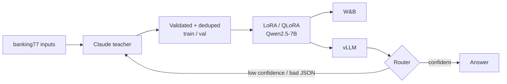

# Model Distillation Pipeline

**Task:** intent classification over the 77 intents of **PolyAI banking77** (real customer messages). The task is narrow, the teacher does it well, and it has gold labels for honest measurement.
**Result:** _paste `results/benchmark.md` (quality / cost per 1k / p50 / p95 for teacher vs student), the break-even request volume from `breakeven.py`, and the escalation rate from `router_eval.py`._

## Architecture


## Run
```bash
cp .env.example .env && pip install -r requirements.txt   # on the GPU box also: pip install vllm
python -m src.teacher_eval --n 500             # Phase 1: teacher accuracy on gold held-out (ceiling)
python -m src.generate --limit 6000            # Phase 2: shows estimate, asks to confirm, logs actual cost
python -m src.train --rank 8  --out outputs/r8            # Phase 3: two configs to compare
python -m src.train --rank 32 --out outputs/r32 --qlora
bash src/serve.sh outputs/r8 outputs/r32       # Phase 5: vLLM with LoRA adapters
python -m src.benchmark --n 1000 --concurrency 8           # Phase 4: untouched test split, 3 axes
python -m src.load_test                        # throughput vs concurrency, latency knee
python -m src.breakeven                        # break-even req/day (always-on GPU, idle time counted)
uvicorn src.router:app --port 8010 & python -m src.router_eval --n 300   # student → teacher escalation
```

## Phases → code
| Phase | Where |
|---|---|
| 1. Narrow task + teacher ceiling | `src/common.py`, `src/teacher_eval.py` |
| 2. Training set from teacher | `src/generate.py`: real inputs, enum-constrained teacher output, invalid outputs dropped, exact **and near-duplicate** inputs removed (MinHash + LSH, Jaccard ≥ 0.8 on word 3-grams), train/val split; test split never touched. The loader refuses a dataset copy whose label names are missing |
| 3. LoRA/QLoRA student (Qwen2.5-7B-Instruct by default) | `src/train.py`: loss on answer tokens only; W&B logs loss, LR schedule, per-epoch val accuracy and a sample-output table |
| 4. 3-axis benchmark | `src/benchmark.py`: student cost = GPU $/h ÷ (measured throughput × realistic utilisation) |
| 5. Serve + break-even + router | `src/serve.sh`, `src/load_test.py`, `src/breakeven.py` (scales to N GPUs; says so if self-hosting never wins; clear error if the teacher wasn't benchmarked), `src/router.py` (escalates on schema failure or sequence confidence < threshold) |

If the student underperforms, publish that and explain why. A reported negative result is more credible than a perfect one.
