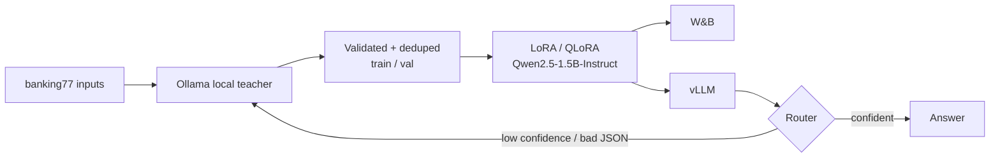

# Model Distillation Pipeline

**Task:** intent classification over the 77 intents of **PolyAI banking77** (real customer messages). The task is narrow, the teacher does it well, and it has gold labels for honest measurement.
**Result:** _paste `results/benchmark.md` (quality / local hardware cost / p50 / p95 for teacher vs student), the local capacity estimate from `breakeven.py`, and the escalation rate from `router_eval.py`._

## Architecture


## Run
```bash
cp .env.example .env && pip install -r requirements.txt
ollama list                                     # verify Ollama is running and check installed models
ollama pull qwen2.5-coder:3b                   # only if the teacher model is not installed
# On the GPU box only: pip install vllm
python -m src.teacher_eval --n 500             # Phase 1: teacher accuracy on gold held-out (ceiling)
python -m src.generate --limit 6000            # Phase 2: labels local inputs; no API cost prompt
python -m src.train --rank 8  --out outputs/r8            # Phase 3: two configs to compare
python -m src.train --rank 32 --out outputs/r32 --qlora
bash src/serve.sh outputs/r8 outputs/r32       # Phase 5: vLLM serves the trained LoRA student on :8000
python -m src.benchmark --n 1000 --concurrency 8           # Phase 4: untouched test split, 3 axes
python -m src.load_test                        # throughput vs concurrency, latency knee
python -m src.breakeven                        # local hardware cost/capacity (no API break-even)
uvicorn src.router:app --port 8010 & python -m src.router_eval --n 300   # student → teacher escalation
```

Configure `OLLAMA_MODEL` and `OLLAMA_BASE_URL` in `.env` to select the local teacher model and Ollama server. By default, `qwen2.5-coder:3b` is the Ollama teacher and `Qwen/Qwen2.5-1.5B-Instruct` is the distinct student fine-tuned with LoRA/QLoRA. The student is loaded from Hugging Face through Transformers and served through vLLM; Ollama's local teacher inference has no metered API charge, but still uses local hardware.

During Phase 2, the generation script reports progress for near-duplicate removal and Ollama labeling, including processing rate and estimated time remaining.

## Complete Google Colab notebook

The following steps run the teacher, data generation, training, persistence, and inference entirely in a Colab GPU session. Colab resource availability and session limits still apply. The T4 is suitable for QLoRA, and the training script automatically uses FP16 on a T4.

Run each section in one Colab notebook. The notebook can contain shell commands with `!` and project Python commands with `!python`.

### 1. Select a GPU runtime and mount Drive

Choose **Runtime → Change runtime type → T4 GPU**.

```python
from google.colab import drive
drive.mount("/content/drive")
```

```bash
!nvidia-smi
```

The GPU check must show a CUDA device. If it does not, reconnect or change the runtime type before continuing.

### 2. Clone the project

Replace the URL with this repository URL. For a private repository, give Colab access through GitHub or place a clone of the private repository on Drive; do not paste a personal access token into a notebook.

```bash
%cd /content
!git clone https://github.com/karthikaditya/p5_distillation.git
%cd /content/p5_distillation
```

If the repository directory already exists, reconnect to its existing runtime or remove the old clone in a separate cleanup step before cloning again.

### 3. Create a persistent Drive directory

```bash
!mkdir -p /content/drive/MyDrive/p5_distillation/{data,outputs,results}
%cd /content/p5_distillation
```

### 4. Install Python dependencies

vLLM is not required for Colab fine-tuning or single-example inference.

```bash
%pip install -q "transformers>=4.44" "peft>=0.12" "accelerate>=0.33" "datasets>=2.20" "wandb>=0.17" "bitsandbytes>=0.43" "ollama>=0.4" "python-dotenv>=1.0"
```

If Colab asks to restart the runtime after installation, restart it, remount Drive, and return to `/content/p5_distillation` before continuing.

### 5. Start Ollama and install the teacher

This runs Ollama inside Colab. The first pull can take several minutes.

```bash
!curl -fsSL https://ollama.com/install.sh | sh
!nohup ollama serve >/tmp/ollama.log 2>&1 &
```

Wait for Ollama to respond, then pull the teacher:

```bash
!for i in {1..30}; do curl -fsS http://localhost:11434/api/tags >/dev/null && break; sleep 2; done
!ollama list
!ollama pull qwen2.5-coder:3b
!ollama list
```

The model must appear in `ollama list` before running teacher evaluation or generation.

### 6. Optional: authenticate W&B

Training is configured to use W&B. Login is optional, but you must disable W&B or provide an account if you do not want remote logging.

```python
import wandb
wandb.login()
```

Do not put an API key in the notebook. If you prefer no W&B logging, set `WANDB_MODE=disabled` in the next shell command:

```bash
%env WANDB_MODE=disabled
```

### 7. Evaluate the gold teacher ceiling

This uses the 500-example held-out gold set and does not modify the untouched test split.

```bash
!python -m src.teacher_eval --n 500 --workers 8
!cp results/teacher_eval.json /content/drive/MyDrive/p5_distillation/results/
!cat results/teacher_eval.json
```

### 8. Generate and save the training data

This labels, validates, and de-duplicates the real-message pool with Ollama:

```bash
!python -m src.generate --limit 6000 --workers 8
```

For a first T4 trial, `--limit 1000` is faster. Check the generated files and copy them to Drive:

```bash
!ls -lh data/train.jsonl data/val.jsonl
!cp data/train.jsonl data/val.jsonl /content/drive/MyDrive/p5_distillation/data/
!cp results/generation_stats.json /content/drive/MyDrive/p5_distillation/results/
!wc -l data/train.jsonl data/val.jsonl
```

The run creates `data/train.jsonl` and `data/val.jsonl`. Save both files because a later Colab runtime cannot otherwise retain them.

### 9. Train a rank-8 QLoRA adapter

The output is written directly to Drive so it survives runtime disconnection.

```bash
!python -m src.train \
  --rank 8 \
  --out /content/drive/MyDrive/p5_distillation/outputs/r8 \
  --qlora \
  --batch 2 \
  --grad-accum 4 \
  --epochs 2
```

If it reports CUDA out-of-memory, retry with `--batch 1 --grad-accum 8`. Do not interrupt the notebook before epoch saving finishes.

### 10. Optionally train rank 32

Rank 32 usually uses more memory and takes longer. Run it only after rank 8 succeeds:

```bash
!python -m src.train \
  --rank 32 \
  --out /content/drive/MyDrive/p5_distillation/outputs/r32 \
  --qlora \
  --batch 1 \
  --grad-accum 8 \
  --epochs 2
```

Verify that the selected output contains all final adapter files:

```bash
!ls -lh /content/drive/MyDrive/p5_distillation/outputs/r8
```

The directory must contain `adapter_config.json`, `adapter_model.safetensors`, and `train_config.json`. If a run is interrupted, treat that output directory as incomplete and rerun it.

### 11. Resume in a fresh Colab runtime

For a later session, remount Drive, clone or enter the project, install dependencies, and select a T4 GPU:

```python
from google.colab import drive
drive.mount("/content/drive")
```

```bash
%cd /content
if [ ! -d p5_distillation ]; then git clone https://github.com/karthikaditya/p5_distillation.git; fi
%cd /content/p5_distillation
%pip install -q "transformers>=4.44" "peft>=0.12" "accelerate>=0.33" "bitsandbytes>=0.43" "python-dotenv>=1.0"
```

Then verify the adapter:

```bash
!ls -l /content/drive/MyDrive/p5_distillation/outputs/r8/adapter_config.json \
       /content/drive/MyDrive/p5_distillation/outputs/r8/adapter_model.safetensors
```

### 12. Run inference in Colab

The adapter is a LoRA adapter, not a standalone model. The script loads `Qwen/Qwen2.5-1.5B-Instruct` and attaches the saved adapter.

```bash
!nvidia-smi
!python -m src.infer \
  --adapter /content/drive/MyDrive/p5_distillation/outputs/r8 \
  --text "I lost my card and need a replacement."
```

Use `outputs/r32` instead if rank 32 is the adapter you want to test. The script loads the base model in 4-bit and prints one JSON intent.

### Optional: benchmark and router on a persistent GPU host

The repository's `benchmark.py`, `load_test.py`, `serve.sh`, and `router_eval.py` require vLLM or Ollama services to remain available. They are optional for Colab adapter testing and are intended for a persistent GPU host or a Colab session kept alive with the required service processes. Do not run `src.benchmark` or `src.load_test` until the vLLM student endpoint is serving on port 8000.

## Phases → code
| Phase | Where |
|---|---|
| 1. Narrow task + teacher ceiling | `src/common.py` (Ollama local model), `src/teacher_eval.py` |
| 2. Training set from teacher | `src/generate.py`: real inputs, schema-constrained Ollama output, invalid outputs dropped, exact **and near-duplicate** inputs removed (MinHash + LSH, Jaccard ≥ 0.8 on word 3-grams), train/val split; test split never touched. The loader refuses a dataset copy whose label names are missing |
| 3. LoRA/QLoRA student (`Qwen/Qwen2.5-1.5B-Instruct` by default) | `src/train.py`: loss on answer tokens only; W&B logs loss, LR schedule, per-epoch val accuracy and a sample-output table |
| 4. 3-axis benchmark | `src/benchmark.py`: Ollama teacher API cost is $0; student hardware cost = GPU $/h ÷ (measured throughput × realistic utilisation) |
| 5. Serve + hardware estimate + router | `src/serve.sh`, `src/load_test.py`, `src/breakeven.py` (reports local hardware cost/capacity; API break-even is not applicable), `src/router.py` (escalates on schema failure or sequence confidence < threshold) |

If the student underperforms, publish that and explain why. A reported negative result is more credible than a perfect one.
