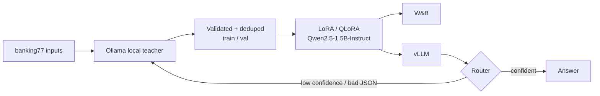

# Model Distillation Pipeline

**Task:** intent classification over the 77 intents of **PolyAI banking77** (real customer messages). The task is narrow, the teacher does it well, and it has gold labels for honest measurement.
**Result:** _paste `results/benchmark.md` (quality / local hardware cost / p50 / p95 for teacher vs student), the local capacity estimate from `breakeven.py`, and the escalation rate from `router_eval.py`._

## Architecture


## Run
```bash
cp .env.example .env && pip install -r requirements.txt
ollama list                                     # verify Ollama is running and check installed models
ollama pull qwen2.5-coder:3b                   # only if the teacher model is not installed
# On the GPU box only: pip install vllm
python -m src.teacher_eval --n 500             # Phase 1: teacher accuracy on gold held-out (ceiling)
python -m src.generate --limit 6000            # Phase 2: labels local inputs; no API cost prompt
python -m src.train --rank 8  --out outputs/r8            # Phase 3: two configs to compare
python -m src.train --rank 32 --out outputs/r32 --qlora
bash src/serve.sh outputs/r8 outputs/r32       # Phase 5: vLLM serves the trained LoRA student on :8000
python -m src.benchmark --n 1000 --concurrency 8           # Phase 4: untouched test split, 3 axes
python -m src.load_test                        # throughput vs concurrency, latency knee
python -m src.breakeven                        # local hardware cost/capacity (no API break-even)
uvicorn src.router:app --port 8010 & python -m src.router_eval --n 300   # student → teacher escalation
```

Configure `OLLAMA_MODEL` and `OLLAMA_BASE_URL` in `.env` to select the local teacher model and Ollama server. By default, `qwen2.5-coder:3b` is the Ollama teacher and `Qwen/Qwen2.5-1.5B-Instruct` is the distinct student fine-tuned with LoRA/QLoRA. The student is loaded from Hugging Face through Transformers and served through vLLM; Ollama's local teacher inference has no metered API charge, but still uses local hardware.

## Fine-tune on Google Colab (T4)

If your computer has no GPU, use a Colab GPU runtime for the training phase. A T4 with 15 GB of GPU memory is a reasonable starting point for QLoRA on the default 1.5B student. Colab GPU availability and runtime duration are not guaranteed; save your data and outputs to Google Drive. The training code automatically selects BF16 on supported GPUs and FP16 on a T4.

The teacher remains Ollama's `qwen2.5-coder:3b`. Generate the labeled examples on your computer first, then transfer the train/validation files to Colab. Colab only runs the student fine-tuning; it does not need to run Ollama.

### 1. Generate training data on your computer

Install the project dependencies and make sure Ollama is running with the teacher model available:

```powershell
ollama pull qwen2.5-coder:3b
python -m src.generate --limit 6000
```

This creates `data/train.jsonl` and `data/val.jsonl`. Confirm both files exist and contain data. Upload them to a Google Drive folder such as `MyDrive/p5_distillation/data/`. Do not upload `.env`; keep credentials and local configuration out of the notebook and repository.

### 2. Push the updated code to GitHub

Commit or push the current project version, including the T4-compatible dtype selection in `src/train.py`, to a repository Colab can access. For a private repository or unpushed changes, upload the source files to Drive instead and copy them into the Colab runtime. Do not include `.env` or credentials.

### 3. Create a Colab notebook and select the T4

Open [Google Colab](https://colab.research.google.com/), create a notebook, then choose **Runtime → Change runtime type → T4 GPU** and save. Mount Google Drive in a code cell:

```python
from google.colab import drive
drive.mount("/content/drive")
```

Verify that the runtime sees the GPU:

```bash
!nvidia-smi
```

If no GPU is listed, check the runtime type and reconnect before proceeding.

### 4. Clone the project and copy the data

For a public GitHub repository, replace the URL below with the repository URL:

```bash
%cd /content
!git clone <your-repository-url> p5_distillation
%cd /content/p5_distillation
```

For a private repository, authenticate using a method appropriate for your account, or copy the source from Drive. Do not put an access token directly into a notebook cell.

Copy the data files from Drive and verify they are present:

```bash
!mkdir -p data
!cp /content/drive/MyDrive/p5_distillation/data/train.jsonl data/
!cp /content/drive/MyDrive/p5_distillation/data/val.jsonl data/
!ls -lh data/train.jsonl data/val.jsonl
```

Adjust the Drive path if you chose a different folder.

### 5. Install training dependencies

Install the training packages in the Colab runtime. vLLM is not needed for fine-tuning:

```bash
%pip install -q "transformers>=4.44" "peft>=0.12" "accelerate>=0.33" "datasets>=2.20" "wandb>=0.17" "bitsandbytes>=0.43" "python-dotenv>=1.0"
```

If Colab requests a runtime restart, restart it, then remount Drive, return to `/content/p5_distillation`, and recopy the data files.

### 6. Authenticate W&B

The training script logs metrics to Weights & Biases. Authenticate in a notebook cell:

```python
import wandb
wandb.login()
```

Follow the prompt to authorize. Do not save an API key in a shared notebook.

### 7. Train the rank-8 QLoRA adapter

Start with a small batch to fit within the T4's GPU memory. The output path is on Drive so it persists if the Colab runtime disconnects:

```bash
!python -m src.train \
  --rank 8 \
  --out /content/drive/MyDrive/p5_distillation/outputs/r8 \
  --qlora \
  --batch 2 \
  --grad-accum 4 \
  --epochs 2
```

If the run runs out of GPU memory, retry with `--batch 1`. Training saves checkpoints by epoch; allow each epoch to finish so its checkpoint is written. When rank 8 completes, rank 32 can be tested separately with a different output directory:

```bash
!python -m src.train \
  --rank 32 \
  --out /content/drive/MyDrive/p5_distillation/outputs/r32 \
  --qlora \
  --batch 2 \
  --grad-accum 4 \
  --epochs 2
```

Check the output directory in Drive for `adapter_config.json`, `adapter_model.safetensors`, and `train_config.json`. Treat the adapter as incomplete if the run was interrupted before final saving.

### 8. Download and use the adapter

Download the completed adapter directory from Google Drive, or copy it from Drive into a Colab session where you have a serving GPU. The saved files are a **LoRA adapter**, not a standalone full model; inference also requires the base model `Qwen/Qwen2.5-1.5B-Instruct`.

This PC has no GPU, so the repository's vLLM serving and GPU benchmark phases will not run locally. Run those phases on a GPU host with vLLM installed, using the downloaded adapter and the matching base model. Colab runtimes can disconnect or expire, so keep the completed adapter and source data in Drive.

## Phases → code
| Phase | Where |
|---|---|
| 1. Narrow task + teacher ceiling | `src/common.py` (Ollama local model), `src/teacher_eval.py` |
| 2. Training set from teacher | `src/generate.py`: real inputs, schema-constrained Ollama output, invalid outputs dropped, exact **and near-duplicate** inputs removed (MinHash + LSH, Jaccard ≥ 0.8 on word 3-grams), train/val split; test split never touched. The loader refuses a dataset copy whose label names are missing |
| 3. LoRA/QLoRA student (`Qwen/Qwen2.5-1.5B-Instruct` by default) | `src/train.py`: loss on answer tokens only; W&B logs loss, LR schedule, per-epoch val accuracy and a sample-output table |
| 4. 3-axis benchmark | `src/benchmark.py`: Ollama teacher API cost is $0; student hardware cost = GPU $/h ÷ (measured throughput × realistic utilisation) |
| 5. Serve + hardware estimate + router | `src/serve.sh`, `src/load_test.py`, `src/breakeven.py` (reports local hardware cost/capacity; API break-even is not applicable), `src/router.py` (escalates on schema failure or sequence confidence < threshold) |

If the student underperforms, publish that and explain why. A reported negative result is more credible than a perfect one.
